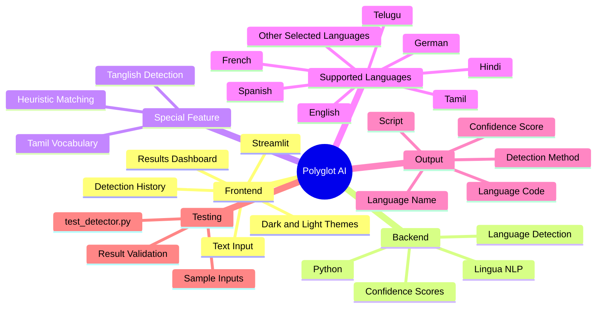
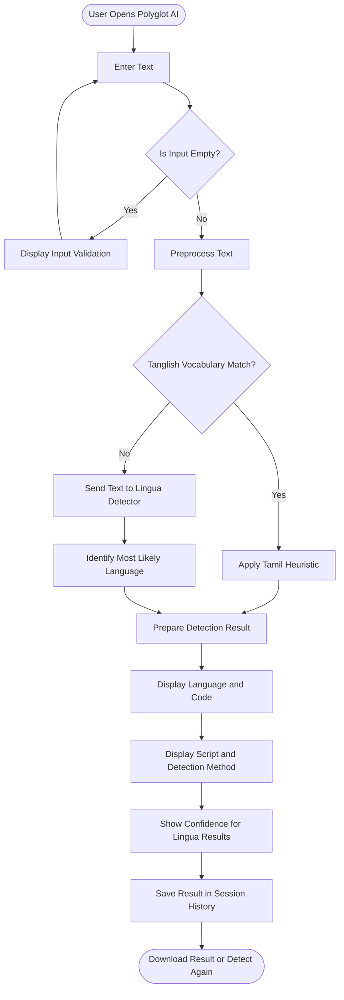

# 🌍 Polyglot AI
### AI-Powered Multilingual Language Detection System

**Discover the language behind your words.**

Polyglot AI is a multilingual language detection application built with Python, Lingua NLP, and Streamlit. It identifies the language of user-provided text, displays language codes and detection confidence, and includes a custom vocabulary-based heuristic for recognizing Tamil written in English letters (Tanglish).

---
    
## ✨ Features

- 🌐 **Multilingual Detection** – Detects 20 selected languages.
- 🇮🇳 **Tamil Support** – Detects Tamil written in its native script.
- 💬 **Tanglish Recognition** – Recognizes common Tamil transliterated words using a vocabulary-based heuristic.
- 📊 **Detection Results** – Displays language name, language code, script, and detection method.
- 📈 **Confidence Score** – Displays Lingua's relative confidence score for supported model detections.
- 🌓 **Dark & Light Themes** – Switch between two visual themes.
- 📝 **Detection History** – Keeps recent results during the app session.
- 📥 **Download Results** – Export detection results as a text file.
- 🧪 **Test Suite** – Includes sample language tests.

---

## 🧠 Project Mind Map



---

## 🔄 Project Workflow



---

## ⚙️ How It Works

Polyglot AI uses two detection approaches:

### 1. Lingua NLP Detection

The Lingua language detection library analyzes the input text and identifies the most likely language from the configured language set.

It returns:
- Detected language
- ISO language code
- Relative confidence score

### 2. Tamil Tanglish Detection

Tanglish is Tamil written using English letters.

For example:

`Vanakkam! Eppadi irukeenga?`

Since this is transliterated Tamil, the application uses a predefined Tamil vocabulary list and a simple matching heuristic to identify common Tanglish expressions.

**Note:** Tanglish detection is heuristic-based, not a machine-learning model prediction. It may produce false positives for ambiguous words.

---

## 🌐 Supported Languages

The current Lingua configuration includes these 20 languages:

| Language | Code |
|---|---|
| English | en |
| Tamil | ta |
| French | fr |
| Spanish | es |
| German | de |
| Hindi | hi |
| Telugu | te |
| Bengali | bn |
| Gujarati | gu |
| Marathi | mr |
| Punjabi | pa |
| Urdu | ur |
| Chinese | zh |
| Japanese | ja |
| Korean | ko |
| Arabic | ar |
| Portuguese | pt |
| Italian | it |
| Russian | ru |
| Tswana | tn |

Additional heuristic support: **Tamil (Tanglish)** – `ta-Latn`.

---

## 🛠️ Technologies Used

| Technology | Purpose |
|---|---|
| Python | Core programming language |
| Lingua NLP | Language detection |
| Streamlit | Web application interface |
| Regular Expressions | Text processing |
| Git & GitHub | Version control and project hosting |

---

## 📁 Project Structure

```text
Polyglot-AI/
│
├── app.py
│   └── Streamlit application and user interface
│
├── detector.py
│   └── Language detection logic and Tanglish heuristic
│
├── test_detector.py
│   └── Language detection test cases
│
├── requirements.txt
│   └── Project dependencies
│
└── README.md
    └── Project documentation
```

---

## 🚀 Installation & Setup

### 1. Clone the repository

```bash
git clone https://github.com/21vicky/Polyglot-AI.git
```

### 2. Navigate into the project

```bash
cd Polyglot-AI
```

### 3. Create a virtual environment

```bash
python -m venv venv
```

### 4. Activate the environment

**Windows PowerShell:**

```powershell
.\venv\Scripts\Activate.ps1
```

### 5. Install dependencies

```bash
pip install -r requirements.txt
```

### 6. Run the application

```bash
streamlit run app.py
```

The application will open in your browser.

---

## 🧪 Testing

Run the language detection test file:

```bash
python test_detector.py
```

### Test Results

| Test Input | Expected Result | Status |
|---|---|---|
| Hello, how are you? | English | ✅ Passed |
| Vanakkam! Eppadi irukeenga? | Tamil (Tanglish) | ✅ Passed |
| நான் நன்றாக இருக்கிறேன். | Tamil | ✅ Passed |
| नमस्ते, आप कैसे हैं? | Hindi | ✅ Passed |
| మీరు ఎలా ఉన్నారు? | Telugu | ✅ Passed |
| Bonjour, comment allez-vous? | French | ✅ Passed |
| Hola, como estas? | Spanish | ✅ Passed |
| Guten Morgen! | German | ✅ Passed |

**Test Summary:** 8/8 sample tests returned the expected language labels.

---

## 📊 Understanding Confidence Scores

Lingua provides confidence values for its language predictions.

These scores represent the model's relative confidence among the configured language candidates. They should not be interpreted as guaranteed prediction accuracy.

Tanglish results use a vocabulary heuristic and therefore do not have a Lingua confidence score.

---

## 🔮 Future Improvements

- Add more language support.
- Improve Tanglish recognition with a larger vocabulary.
- Add automatic script identification.
- Explore speech-based language detection.
- Add multilingual document analysis.
- Improve detection for short and ambiguous text.

---

## 👨‍💻 Author

**Vignesh U**

Full Stack Developer | Python | AI & Data Analytics

- GitHub: [@21vicky](https://github.com/21vicky)

---

## 🎯 Project Challenge

**Day 12 of 30 Days – 30 AI Projects**

Building practical AI projects to strengthen Python, machine learning, NLP, and application development skills.

**Less Guessing. More Language Understanding. 🌍**